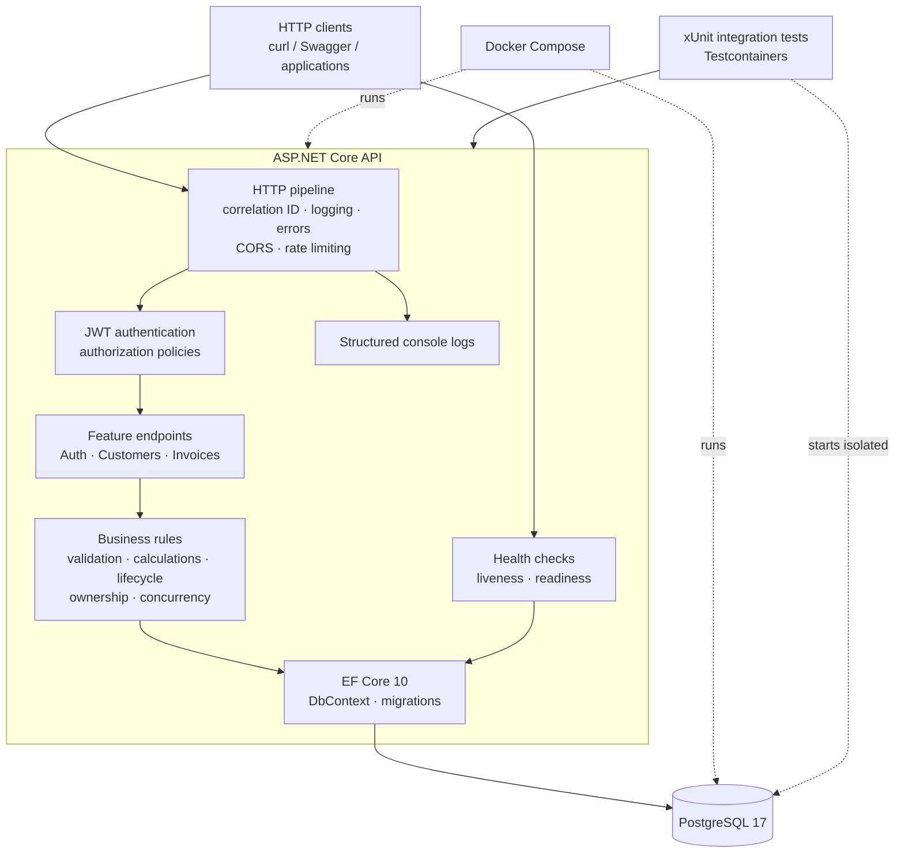

# InvoiceFlow API

**Production-oriented invoice management REST API built with ASP.NET Core and PostgreSQL.**

InvoiceFlow is a portfolio project that demonstrates how a small-business invoicing backend can be built
with explicit business rules, secure data ownership, exact financial arithmetic, real-database integration
tests, and a reproducible container workflow. It is an independent sample application—not a payment
processor, accounting product, or client system—and contains no real customer data.

## What this project demonstrates

- JWT authentication, ASP.NET Core Identity, and User/Admin authorization
- Owner-isolated customer and invoice management
- Multi-item Draft invoices with deterministic `decimal` calculations and line-level rounding
- Guarded invoice lifecycle: Draft → Sent → Paid, with Draft/Sent → Cancelled
- Optimistic concurrency through opaque tokens backed by PostgreSQL `xmin`
- Database-side pagination, filtering, search, and allow-listed sorting
- RFC 9457 ProblemDetails across validation, authentication, conflicts, rate limits, and server errors
- Correlation IDs, structured request logging, explicit CORS, and fixed-window rate limiting
- Liveness and PostgreSQL-backed readiness checks
- Explicit EF Core migrations and a separate migration-bundle container
- Non-root multi-stage Docker image and Docker Compose environment
- 284 tests, including PostgreSQL 17 integration tests through Testcontainers
- GitHub Actions for Release builds, tests, Docker builds, and Compose validation

## Technology stack

| Area | Technology |
| --- | --- |
| Runtime | .NET 10, ASP.NET Core controller-based Web API |
| Language | C# with nullable reference types and warnings as errors |
| Persistence | PostgreSQL 17, EF Core 10, Npgsql, explicit migrations |
| Identity | ASP.NET Core Identity with `Guid` users and roles |
| Authentication | HS256 JWT bearer tokens |
| API documentation | OpenAPI and Swagger UI in Development |
| Testing | xUnit, `WebApplicationFactory`, Testcontainers |
| Operations | Structured logging, correlation IDs, rate limiting, health checks |
| Delivery | Docker, Docker Compose, GitHub Actions |

## Architecture

InvoiceFlow is a feature-oriented modular monolith. ASP.NET Core hosts one deployable process, feature
controllers enforce authorization and business workflows, EF Core manages transactions and persistence,
and PostgreSQL provides relational integrity, exact numeric storage, sequencing, and row versions.



There are no microservices, message brokers, caches, or background workers. See
[Architecture](docs/architecture.md) and [Engineering decisions](docs/engineering-decisions.md) for the
boundaries and trade-offs.

## Quick start with Docker Compose

Prerequisites: Docker with Compose v2, `curl`, and `jq` for the demo.

```bash
cp .env.example .env
# Replace POSTGRES_PASSWORD and Jwt__SigningKey in .env with local values.

docker compose build
docker compose up -d
docker compose run --rm migrator

curl http://localhost:8080/health/live
curl http://localhost:8080/health
```

Compose exposes only the API at `127.0.0.1:8080`; PostgreSQL remains on the private network. Migrations are
never applied automatically. Existing data is retained in the `invoiceflow_postgres-data` named volume.

Run the complete, repeatable demo without deleting or resetting data:

```bash
./scripts/demo.sh
```

The script creates a uniquely named User, customer, and multi-item invoice; updates the Draft; sends and
marks it Paid; then verifies that a terminal invoice cannot be updated. It does not print the password or
JWT. See [API examples](docs/api-examples.md) for every request and representative response.

Stop containers without deleting the database:

```bash
docker compose down
```

## Local .NET development

The repository pins the .NET SDK in `global.json`. Start PostgreSQL, set the connection string and a random
signing key, then apply migrations explicitly:

```bash
export ConnectionStrings__DefaultConnection="Host=localhost;Port=5432;Database=invoiceflow;Username=invoiceflow;Password=<local-password>"
export Jwt__SigningKey="$(openssl rand -base64 48)"

dotnet tool restore
dotnet ef database update \
  --project src/InvoiceFlow.Api \
  --startup-project src/InvoiceFlow.Api

dotnet run --project src/InvoiceFlow.Api
```

Development resources use the launch profile:

| Resource | URL |
| --- | --- |
| Swagger UI | `http://localhost:5188/swagger` |
| OpenAPI document | `http://localhost:5188/openapi/v1.json` |
| Liveness | `http://localhost:5188/health/live` |
| Readiness | `http://localhost:5188/health` |

Swagger and OpenAPI are disabled outside Development.

## API workflow

```text
POST /api/auth/register
POST /api/auth/login
GET  /api/auth/me
POST /api/customers
POST /api/invoices
PUT  /api/invoices/{id}
POST /api/invoices/{id}/send
POST /api/invoices/{id}/mark-paid
```

Invoice totals are server-controlled. For example, these lines:

```json
[
  { "description": "API implementation", "quantity": 2.5, "unitPrice": 1200.00, "taxRate": 20.00 },
  { "description": "Integration testing", "quantity": 3, "unitPrice": 450.00, "taxRate": 10.00 }
]
```

produce `subtotal: 4350.00`, `taxTotal: 735.00`, and `grandTotal: 5085.00`. Clients submit no calculated
amounts. Update and lifecycle requests must use the latest opaque `concurrencyToken`; stale writes return
`409 Conflict`.

Full request and response contracts are in [docs/api-examples.md](docs/api-examples.md).

## Testing

```bash
dotnet restore InvoiceFlow.slnx
dotnet build InvoiceFlow.slnx --configuration Release --no-restore
dotnet test InvoiceFlow.slnx --configuration Release --no-build
```

- **75 unit tests** cover deterministic calculations, lifecycle rules, token encoding, JWT behavior,
  validation, model metadata, correlation IDs, and rate-limit partitioning.
- **209 integration tests** boot the real HTTP pipeline and use disposable PostgreSQL 17 containers with
  committed migrations. They cover authentication, authorization, CRUD, financial persistence, lifecycle,
  concurrency, database constraints, ProblemDetails, CORS, rate limits, and health checks.

Docker must be running for integration tests. The last local Phase 10 verification passed all **284 tests**
with zero build warnings and errors. The GitHub Actions workflow independently repeats the Release build,
unit and PostgreSQL integration tests, Docker image builds, and Compose validation.

## Security considerations

- Ownership is derived from the validated JWT, never accepted from request bodies.
- Cross-owner resources return `404`, reducing resource-existence disclosure.
- Password hashing and lockout use ASP.NET Core Identity; public registration creates only Users.
- JWT signature, issuer, audience, lifetime, and HS256 algorithm are validated.
- Signing keys and database passwords are supplied at runtime; `.env` is ignored.
- Logs exclude bodies, credentials, authorization headers, tokens, and connection strings.
- CORS allows no origins by default; trusted reverse proxies must be configured explicitly.
- Containers run as a non-root user and PostgreSQL is not exposed by Compose.

Important limitations: JWTs are not revocable before expiry, rate limits are in-memory per API instance,
TLS termination and secret storage are deployment responsibilities, and this repository has not undergone
an independent security audit.

## Scope

InvoiceFlow intentionally excludes real payment processing, refunds, PDF generation, e-mail delivery,
webhooks, audit-history tables, multi-currency conversion, cloud infrastructure, and a frontend. Marking an
invoice Paid records only a business status transition.

## Documentation

- [API examples](docs/api-examples.md)
- [Architecture](docs/architecture.md)
- [Engineering decisions](docs/engineering-decisions.md)
- [Requirements](docs/requirements.md)
- [Development plan](docs/development-plan.md)
- [Release readiness](docs/release-readiness.md)
- [Contributing](CONTRIBUTING.md)
- [CI workflow](.github/workflows/ci.yml)

## License

InvoiceFlow is available under the [MIT License](LICENSE).
