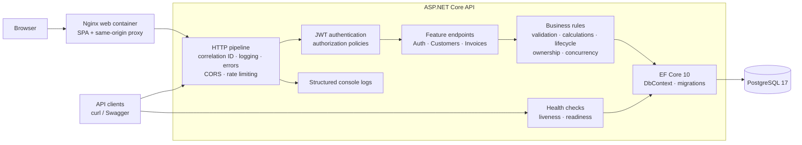
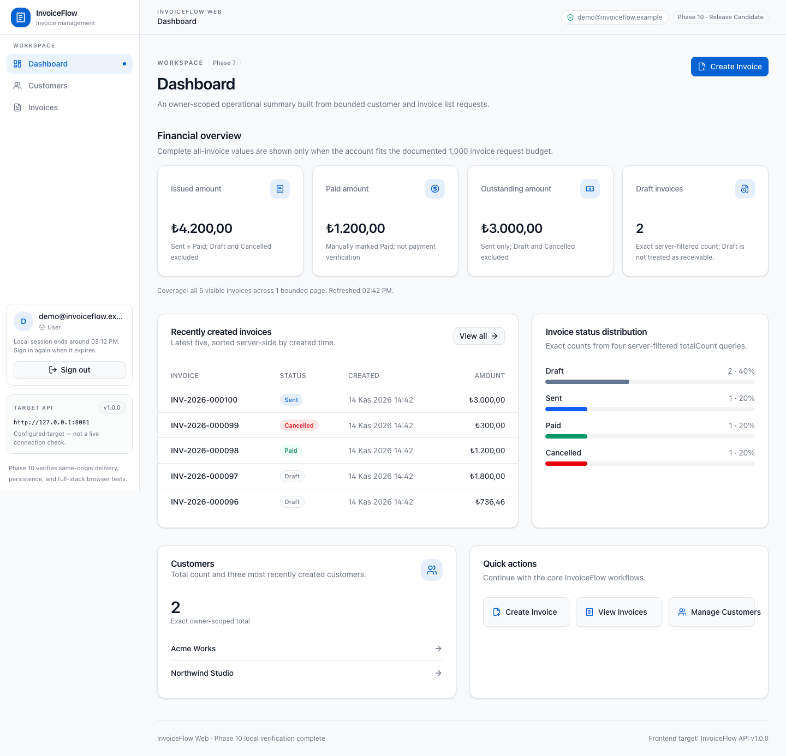
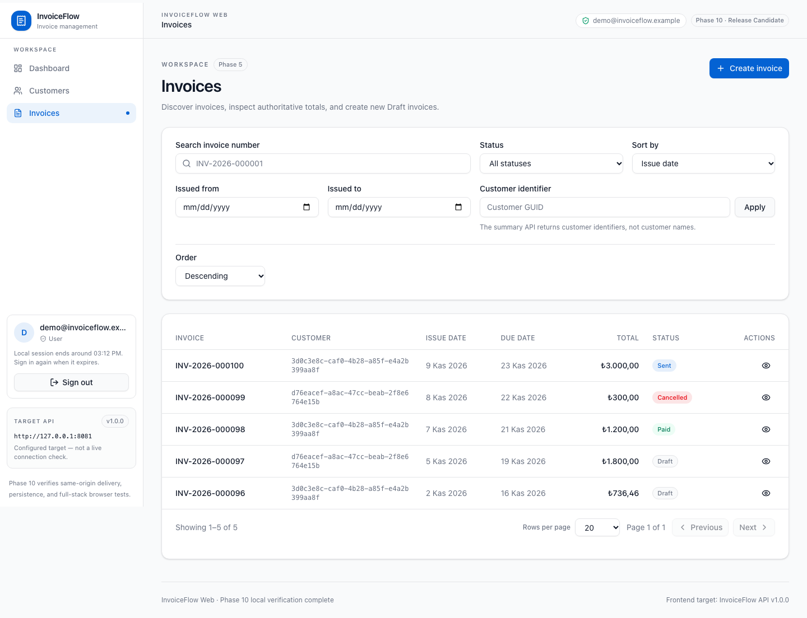
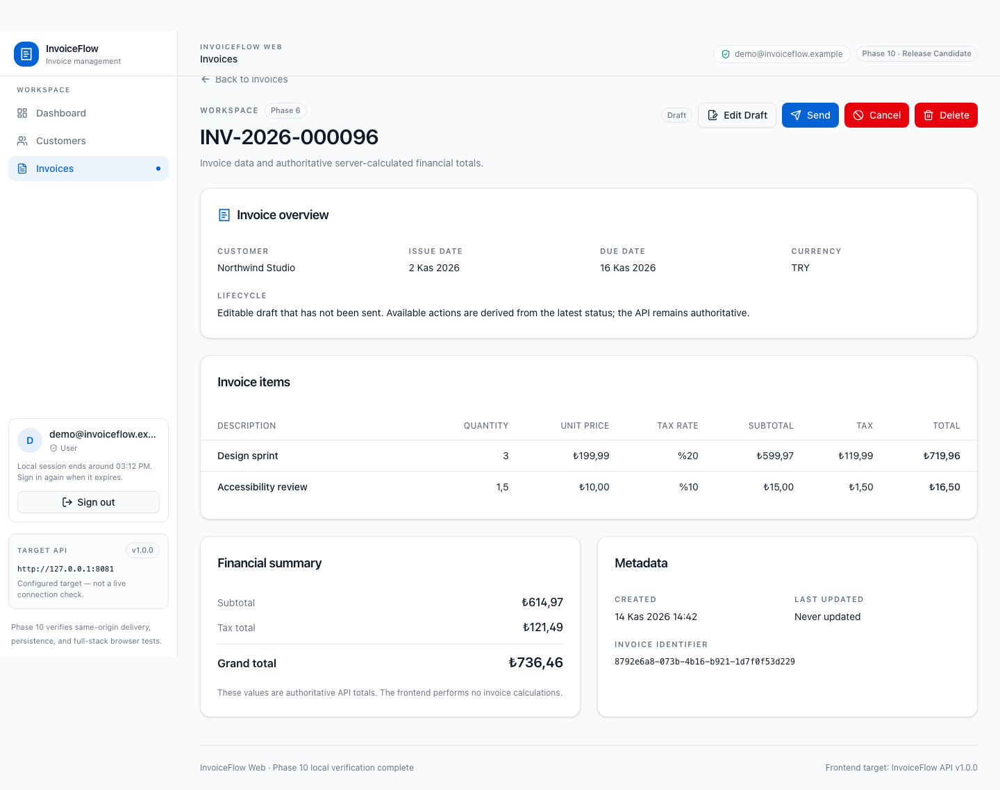
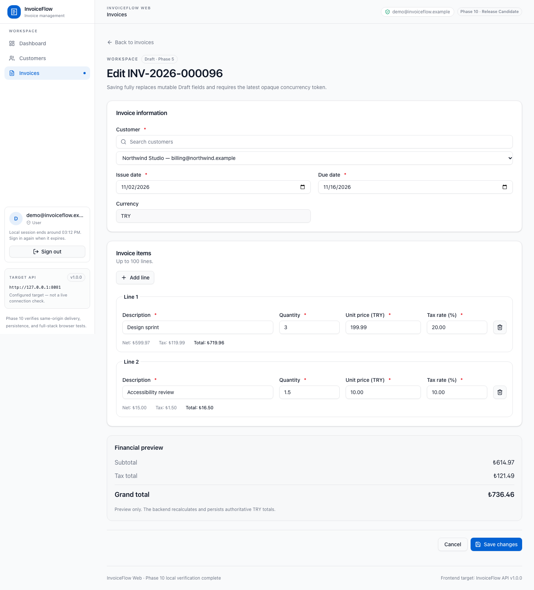
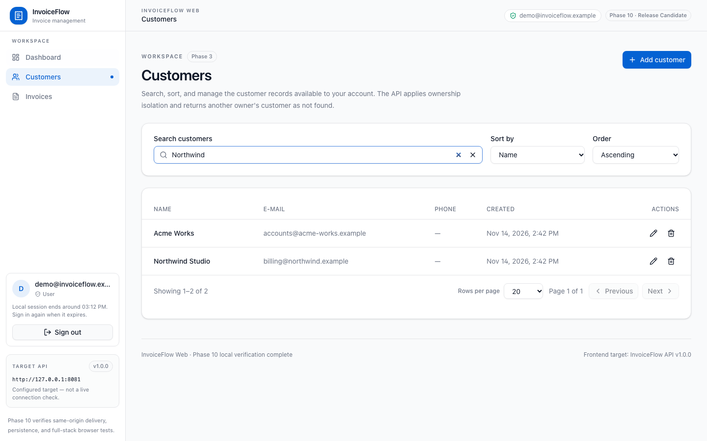
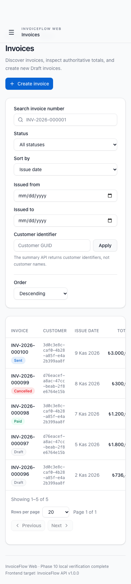

# InvoiceFlow

[](https://github.com/emrealtinbas/InvoiceFlow/actions/workflows/ci.yml)

**Production-oriented invoice management portfolio application built with ASP.NET Core, React, and PostgreSQL.**

InvoiceFlow is a portfolio project that demonstrates how a small-business invoicing backend can be built
with explicit business rules, secure data ownership, exact financial arithmetic, real-database integration
tests, and a reproducible container workflow. It is an independent sample application—not a payment
processor, accounting product, or client system—and contains no real customer data.

A production-style React frontend lives in [`frontend/`](frontend/README.md). It delivers authentication,
customer and invoice workflows, guarded lifecycle actions, bounded dashboard analytics, accessibility
hardening, a same-origin Nginx container, and Playwright E2E infrastructure.

> **Release status:** Phase 10 local verification is complete — backend and frontend suites, image
> builds, full Compose startup, Nginx behavior, restart persistence, six Playwright scenarios, and the
> authenticated Phase 8 browser checks all pass in this environment. The release stays **blocked** until a
> candidate commit is authorized and the same commit passes remote GitHub Actions. See the
> [release-readiness matrix](docs/release-readiness.md).

## What this project demonstrates

- JWT authentication, ASP.NET Core Identity, and User/Admin authorization
- Owner-isolated customer and invoice management
- Multi-item Draft invoices with deterministic `decimal` calculations and line-level rounding
- Guarded invoice lifecycle: Draft → Sent → Paid, with Draft/Sent → Cancelled
- Optimistic concurrency through opaque tokens backed by PostgreSQL `xmin`
- Database-side pagination, filtering, search, and allow-listed sorting
- RFC 9457 ProblemDetails across validation, authentication, conflicts, rate limits, and server errors
- Correlation IDs, structured request logging, explicit CORS, and fixed-window rate limiting
- Liveness and PostgreSQL-backed readiness checks
- Explicit EF Core migrations and a separate migration-bundle container
- Non-root multi-stage API and web images with an optional full-stack Compose profile
- A 284-test backend suite, including PostgreSQL 17 integration tests through Testcontainers
- GitHub Actions for backend/frontend quality, Docker builds, Compose validation, and full-stack E2E
- React 19 + TypeScript frontend with 216 unit/component tests and six Playwright E2E scenarios

## Technology stack

| Area              | Technology                                                                  |
| ----------------- | --------------------------------------------------------------------------- |
| Runtime           | .NET 10, ASP.NET Core controller-based Web API                              |
| Language          | C# with nullable reference types and warnings as errors                     |
| Persistence       | PostgreSQL 17, EF Core 10, Npgsql, explicit migrations                      |
| Identity          | ASP.NET Core Identity with `Guid` users and roles                           |
| Authentication    | HS256 JWT bearer tokens                                                     |
| API documentation | OpenAPI and Swagger UI in Development                                       |
| Testing           | xUnit, `WebApplicationFactory`, Testcontainers                              |
| Operations        | Structured logging, correlation IDs, rate limiting, health checks           |
| Delivery          | Docker, Docker Compose, GitHub Actions                                      |
| Frontend          | React 19, TypeScript, Vite, Tailwind CSS, shadcn/ui, TanStack Query, Vitest |

## Architecture

InvoiceFlow is a feature-oriented modular monolith. ASP.NET Core hosts one deployable process, feature
controllers enforce authorization and business workflows, EF Core manages transactions and persistence,
and PostgreSQL provides relational integrity, exact numeric storage, sequencing, and row versions.



There are no microservices, message brokers, caches, or background workers. See
[Architecture](docs/architecture.md) and [Engineering decisions](docs/engineering-decisions.md) for the
boundaries and trade-offs.

## Quick start with Docker Compose

Prerequisites: Docker with Compose v2, `curl`, and `jq` for the demo.

```bash
cp .env.example .env
# Replace POSTGRES_PASSWORD and Jwt__SigningKey in .env with local values.

docker compose up -d --build --wait

curl http://localhost:8080/health/live
curl http://localhost:8080/health
```

Compose starts the services in dependency order:

1. `postgres` starts and becomes healthy.
2. `migrator` applies the committed EF Core migrations and exits successfully.
3. `api` starts only after migration succeeds.

Docker Desktop shows all three under the `invoiceflow` Compose application. The `migrator` container being
`Exited (0)` is expected; it is a successful one-off task, not a long-running service. Compose exposes only
the API at `127.0.0.1:8080`; PostgreSQL remains on the private network. The API never applies migrations
itself. Existing data is retained in the `invoiceflow_postgres-data` named volume.

Start the complete browser stack with the optional web profile:

```bash
docker compose --profile web up -d --build --wait
curl http://localhost:8081/health
open http://localhost:8081
```

The browser connects only to Nginx at `127.0.0.1:8081`. Nginx serves immutable hashed assets, applies SPA
fallback and security headers, and proxies `/api/*` and `/health*` over the private Compose network to the
API. No `api` or `postgres` service name is embedded in JavaScript. Set `WEB_PORT` to change the host port.
The profile is opt-in, so the established API-only `docker compose up` workflow remains unchanged.

Run the complete, repeatable demo without deleting or resetting data:

```bash
./scripts/demo.sh
```

The script creates a uniquely named User, customer, and multi-item invoice; updates the Draft; sends and
marks it Paid; then verifies that a terminal invoice cannot be updated. It does not print the password or
JWT. See [API examples](docs/api-examples.md) for every request and representative response.

Stop containers without deleting the database:

```bash
docker compose down
```

## Local .NET development

The repository pins the .NET SDK in `global.json`. Start PostgreSQL, set the connection string and a random
signing key, then apply migrations explicitly:

```bash
export ConnectionStrings__DefaultConnection="Host=localhost;Port=5432;Database=invoiceflow;Username=invoiceflow;Password=<local-password>"
export Jwt__SigningKey="$(openssl rand -base64 48)"

dotnet tool restore
dotnet ef database update \
  --project src/InvoiceFlow.Api \
  --startup-project src/InvoiceFlow.Api

dotnet run --project src/InvoiceFlow.Api
```

Development resources use the launch profile:

| Resource         | URL                                     |
| ---------------- | --------------------------------------- |
| Swagger UI       | `http://localhost:5188/swagger`         |
| OpenAPI document | `http://localhost:5188/openapi/v1.json` |
| Liveness         | `http://localhost:5188/health/live`     |
| Readiness        | `http://localhost:5188/health`          |

Swagger and OpenAPI are disabled outside Development.

## Web frontend

The React + TypeScript application provides the complete sample UI through Phase 10: memory-only JWT
sessions, customer CRUD, invoice editing and lifecycle, honest dashboard analytics, accessibility hardening,
and container/E2E delivery infrastructure.

```bash
cd frontend
npm install
cp .env.example .env
npm run dev
```

The dev server runs at `http://localhost:5173` and expects the API at `http://localhost:8080` by default.
Because the API allows no cross-origin requests by default, set
`Cors__AllowedOrigins__0=http://localhost:5173` for the API process or a local Compose override. See the
[frontend README](frontend/README.md) for prerequisites, scripts, and troubleshooting.

Frontend documentation:

- [Frontend README](frontend/README.md)
- [API contract](frontend/docs/api-contract.md)
- [Frontend development plan](frontend/docs/development-plan.md)

### Browser E2E tests

With the full-stack profile healthy:

```bash
LOGIN_PERMIT_LIMIT=100 REGISTER_PERMIT_LIMIT=100 \
  docker compose --profile web up -d --build --wait
cd frontend
npm ci
npm run test:e2e:install
E2E_BASE_URL=http://127.0.0.1:8081 npm run test:e2e
```

The suite creates seven accounts, so the command uses explicit test-only rate-limit overrides. Normal Compose
startup retains the production-style defaults of 10 logins and 5 registrations per minute.

The six Playwright scenarios use unique disposable accounts and cover authentication/session persistence,
ownership isolation, customer CRUD, invoice financial parity and concurrency, lifecycle terminal states,
dashboard data, Draft deletion, and mobile navigation. Local runs leave terminal invoices and their accounts
because the API intentionally has no account cleanup endpoint. CI uses an isolated Compose project and
removes only its own containers and volume afterward.

## Screenshots

Captured from the verified local full-stack Compose profile at `http://127.0.0.1:8081` with the synthetic
`demo@invoiceflow.example` account and `.example` customer addresses. No real personal data, credentials,
tokens, or environment values appear in these images.

| Dashboard                                             | Invoices                                           |
| ----------------------------------------------------- | -------------------------------------------------- |
|           |       |
| **Invoice detail**                                    | **Draft invoice editor**                           |
|  |  |
| **Customers**                                         | **Mobile invoice list**                            |
|           |  |

## API workflow

```text
POST /api/auth/register
POST /api/auth/login
GET  /api/auth/me
POST /api/customers
POST /api/invoices
PUT  /api/invoices/{id}
POST /api/invoices/{id}/send
POST /api/invoices/{id}/mark-paid
```

Invoice totals are server-controlled. For example, these lines:

```json
[
    {
        "description": "API implementation",
        "quantity": 2.5,
        "unitPrice": 1200.0,
        "taxRate": 20.0
    },
    {
        "description": "Integration testing",
        "quantity": 3,
        "unitPrice": 450.0,
        "taxRate": 10.0
    }
]
```

produce `subtotal: 4350.00`, `taxTotal: 735.00`, and `grandTotal: 5085.00`. Clients submit no calculated
amounts. Update and lifecycle requests must use the latest opaque `concurrencyToken`; stale writes return
`409 Conflict`.

Full request and response contracts are in [docs/api-examples.md](docs/api-examples.md).

## Testing

```bash
dotnet restore InvoiceFlow.slnx
dotnet build InvoiceFlow.slnx --configuration Release --no-restore
dotnet test InvoiceFlow.slnx --configuration Release --no-build
```

- **75 unit tests** cover deterministic calculations, lifecycle rules, token encoding, JWT behavior,
  validation, model metadata, correlation IDs, and rate-limit partitioning.
- **209 integration tests** boot the real HTTP pipeline and use disposable PostgreSQL 17 containers with
  committed migrations. They cover authentication, authorization, CRUD, financial persistence, lifecycle,
  concurrency, database constraints, ProblemDetails, CORS, rate limits, and health checks.

Docker must be running for integration tests. In the current Phase 10 environment, the complete Release
solution builds with zero warnings/errors, all **75 unit tests** and all **209 PostgreSQL integration tests**
pass, and so do the frontend suite, image builds, Compose startup, and the six Playwright scenarios. The
[release-readiness matrix](docs/release-readiness.md) records the executed evidence and the checks that
remain external. GitHub Actions independently repeats the Release build, unit and integration tests,
frontend quality, image builds, Compose validation, and full-stack Chromium E2E. Browser artifacts are
uploaded only on failure.

## Security considerations

- Ownership is derived from the validated JWT, never accepted from request bodies.
- Cross-owner resources return `404`, reducing resource-existence disclosure.
- Password hashing and lockout use ASP.NET Core Identity; public registration creates only Users.
- JWT signature, issuer, audience, lifetime, and HS256 algorithm are validated.
- Signing keys and database passwords are supplied at runtime; `.env` is ignored.
- Logs exclude bodies, credentials, authorization headers, tokens, and connection strings.
- CORS allows no origins by default; trusted reverse proxies must be configured explicitly.
- Containers run as a non-root user and PostgreSQL is not exposed by Compose.

Important limitations: JWTs are not revocable before expiry, rate limits are in-memory per API instance,
TLS termination and secret storage are deployment responsibilities, and this repository has not undergone
an independent security audit.

## Scope

InvoiceFlow intentionally excludes real payment processing, refunds, PDF generation, e-mail delivery,
webhooks, audit-history tables, multi-currency conversion, cloud infrastructure, and managed production
hosting. The frontend container is production-style, but TLS, secret management, backups, observability, and
deployment remain operator responsibilities. Marking an invoice Paid records only a business status
transition.

## Documentation

- [API examples](docs/api-examples.md)
- [Architecture](docs/architecture.md)
- [Engineering decisions](docs/engineering-decisions.md)
- [Requirements](docs/requirements.md)
- [Development plan](docs/development-plan.md)
- [Release readiness](docs/release-readiness.md)
- [Frontend README](frontend/README.md)
- [Frontend API contract](frontend/docs/api-contract.md)
- [Frontend development plan](frontend/docs/development-plan.md)
- [Contributing](CONTRIBUTING.md)
- [CI workflow](.github/workflows/ci.yml)

## License

InvoiceFlow is available under the [MIT License](LICENSE).
