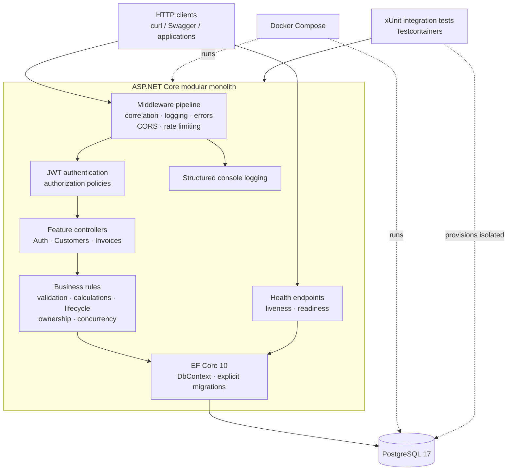
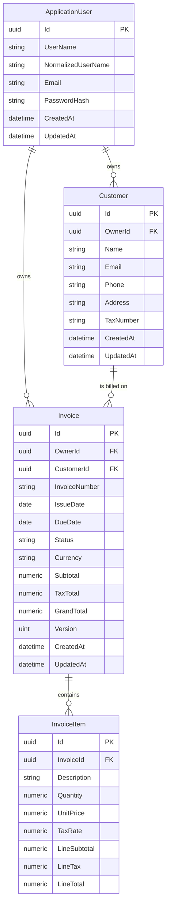

# Architecture

## Overview

InvoiceFlow API is a **pragmatic modular monolith**: a single deployable ASP.NET Core application whose
code is organized by business feature rather than by technical layer. The goal is a codebase that a new
developer (or a potential client reviewing the repository) can understand in minutes, while leaving clear
seams for future growth.

The application deliberately avoids distributed-systems machinery. There is no message broker, no
microservice split, no CQRS framework, and no repository abstraction over EF Core. Those choices would add
operational cost and indirection without solving a problem this product currently has.

## System architecture



Docker Compose is a local orchestration boundary, not an application layer. Testcontainers creates separate,
disposable PostgreSQL instances for integration tests; tests never target the Compose database.

## Why a modular monolith

- **One process, one deployment unit.** Small-business invoicing does not need independent scaling of
  customers and invoices; a single API is cheaper to run and operate.
- **Simple transactions.** Invoice totals and their line items must stay consistent. A single database and
  a single process make that trivial; distributed consistency would not.
- **Clear boundaries without network boundaries.** Features live in separate folders with their own
  entities, configurations, endpoints, and validation. If a feature ever needs to be extracted, the folder
  is the unit of extraction.
- **Lower cognitive load.** Native ASP.NET Core features (dependency injection, model binding, filters,
  middleware, OpenAPI) are used directly instead of wrapping them in custom frameworks.

## Feature-based organization

```text
src/InvoiceFlow.Api/
├── Features/
│   ├── Auth/          # ApplicationUser, Identity, JWT, auth endpoints, admin provisioning
│   ├── Customers/     # Customer entity, validation, contracts, and CRUD endpoints
│   └── Invoices/      # Draft CRUD, calculations, numbering, concurrency, lifecycle
├── Common/            # cross-cutting API concerns: error handling, pagination contracts
├── Infrastructure/
│   ├── Persistence/   # AppDbContext, audit contract, EF Core migrations
│   ├── HealthChecks/  # health response contract
│   └── OpenApi/       # OpenAPI document configuration
├── Program.cs         # composition root and HTTP pipeline
└── appsettings.json
```

Each feature folder contains only what that feature needs: entities, EF Core configurations, request and
response contracts, controllers, feature-specific validation, and services. Features may reference
`Common` and `Infrastructure`, but must not reach into each other's internals. When one feature needs data
owned by another, it goes through a small public service or query contract exposed by the owning feature.

### Why controllers

Controller-based APIs keep request handling, model binding, validation attributes, and OpenAPI metadata
in one predictable place. They also read naturally to .NET reviewers, which matters for a portfolio
repository. Minimal APIs are a fine alternative, but mixing both styles would add inconsistency for no
benefit.

## Application boundaries

| Boundary        | Responsibility                                                        |
| --------------- | --------------------------------------------------------------------- |
| Auth            | Registration, credential verification, JWT issuing, role assignment    |
| Customers       | Customer ownership, CRUD, uniqueness of e-mail per owner, deletion rules |
| Invoices        | Invoice lifecycle, line items, server-side totals, numbering           |
| Common          | ProblemDetails conventions, pagination envelope, shared primitives     |
| Infrastructure  | EF Core `DbContext`, migrations, health checks, auth configuration     |

Authorization is enforced at the edge of each feature: every customer and invoice query is scoped to the
authenticated user, except for administrators.

## Authentication and authorization

### ASP.NET Core Identity

Authentication uses ASP.NET Core Identity for user storage and password hashing. The application uses
`AddIdentityCore<ApplicationUser>()` with `IdentityRole<Guid>`, the EF Core stores, and `SignInManager`;
no cookie authentication schemes are registered because the API is token-based.

Configured policies:

| Setting               | Value                                           |
| --------------------- | ----------------------------------------------- |
| Unique e-mail         | Required (`User.RequireUniqueEmail`)             |
| Password minimum      | 12 characters                                   |
| Password complexity   | Upper-case, lower-case, digit, non-alphanumeric |
| Lockout threshold     | 5 failed attempts                               |
| Lockout duration      | 15 minutes                                      |
| Lockout for new users | Enabled                                         |

Passwords are hashed by Identity's PBKDF2 password hasher. The application never implements its own
cryptographic algorithms, and never returns or logs password hashes or security stamps.

### Registration flow

`POST /api/auth/register`:

1. Validate the request (e-mail format, required fields).
2. Reject an already registered e-mail with `409 Conflict`.
3. Begin an explicit `AppDbContext` transaction.
4. Create the user through `UserManager`, which normalizes the e-mail, validates the password policy, and
   hashes the password.
5. Create the `User` role lazily if it does not exist.
6. Add the user to the `User` role.
7. Commit the transaction and return `201 Created` with `{ id, email, role }`.

The endpoint never accepts a role from the client, never creates an Admin, and does not sign the user in.
If role assignment fails, the transaction is rolled back, so no partially registered account remains.

### Login flow

`POST /api/auth/login`:

1. Find the user by normalized e-mail.
2. Call `SignInManager.CheckPasswordSignInAsync(user, password, lockoutOnFailure: true)`.
3. Return the same generic `401` ProblemDetails for an unknown e-mail, a wrong password, and a locked-out
   account. This avoids disclosing whether an account exists.
4. On success, load the user's roles and issue an HS256 JWT.
5. Return `{ accessToken, tokenType: "Bearer", expiresIn }`.

Failed attempts increment Identity's access-failed count; the fifth failure locks the account for 15
minutes. No refresh token is issued in Phase 3.

### JWT claims and validation

| Claim | Value | Notes |
| ----- | ----- | ----- |
| `sub` | User id | `Guid`; used by `ICurrentUser` |
| `email` | User e-mail | |
| `role` | Identity role | One claim per role (`Admin`, `User`) |
| `iss` | `Jwt:Issuer` | Validated |
| `aud` | `Jwt:Audience` | Validated |
| `iat` | Issued-at | Unix seconds |
| `exp` | Expiration | Unix seconds |
| `jti` | Token id | Unique `Guid` |

Validation is strict:

- HS256 is the only accepted algorithm (`ValidAlgorithms`).
- Unsigned tokens are rejected (`RequireSignedTokens`).
- Issuer, audience, signature, and lifetime are validated.
- Clock skew is limited to 5 seconds.
- `MapInboundClaims` is disabled, the role claim type is `role`, and the name claim type is `email`.

`JwtOptions` is bound from the `Jwt` section and validated at startup. The signing key comes only from
`Jwt__SigningKey`, must be at least 32 bytes, and is never committed or logged. If it is missing or invalid,
the host fails to start with a clear message that does not include the key value.

### Authorization policies

| Policy              | Definition                  | Behavior                             |
| ------------------- | --------------------------- | ------------------------------------ |
| `AdminOnly`         | `RequireRole("Admin")`      | `403` for authenticated non-admins   |
| `AuthenticatedUser` | `RequireAuthenticatedUser()` | `401` for anonymous requests         |

`JwtBearerEvents.OnChallenge` writes a `401` ProblemDetails response and `OnForbidden` writes a `403`
ProblemDetails response. The two roles are `Admin` and `User`; public registration can only create `User`.

### Current user access

`ICurrentUser` is a small scoped service that reads the validated JWT `sub` claim and parses it as a
`Guid`. It returns `null` when the principal is unauthenticated, the claim is absent, or the value is not a
valid `Guid`. Ownership is never taken from a request body. `GET /api/auth/me` uses this service and looks
the user up again, so a token for a deleted account is rejected with `401`.

### Admin provisioning

Admin provisioning is an explicit command, never part of normal startup:

```bash
dotnet run --project src/InvoiceFlow.Api -- --provision-admin
```

It is disabled by default and requires:

| Setting                      | Purpose                    |
| ---------------------------- | -------------------------- |
| `AdminProvisioning__Enabled` | Must be `true` to run      |
| `AdminProvisioning__Email`   | Initial admin e-mail       |
| `AdminProvisioning__Password` | Initial admin password     |

The command ensures the `Admin` and `User` roles exist, creates the admin account once, and is idempotent.
It never overwrites an existing password, never promotes an existing non-admin account, and never logs the
password. Concurrent runs are constrained by Identity's unique e-mail/username indexes and the
find-before-create check.

### Error responses and Swagger

- Every error uses `application/problem+json`. Validation failures return `400` with
  `ValidationProblemDetails`; malformed JSON and model-binding failures use the same shape through a
  custom `InvalidModelStateResponseFactory`.
- A result filter adds `instance`, `traceId`, and `correlationId` to ProblemDetails returned by MVC,
  including manually constructed controller responses and automatic model-state failures.
- Duplicate registration returns `409`; invalid login returns `401`.
- Missing, invalid, expired, or unsigned tokens return `401`; insufficient roles return `403`. The JWT
  bearer events add the same correlation diagnostics to those bodies.
- Unknown routes return `404` ProblemDetails through `UseStatusCodePages()`.
- Rate-limited credential requests return `429` ProblemDetails with `Retry-After` when available.
- Unhandled exceptions return `500` through `UseExceptionHandler()` and a single `IExceptionHandler`.
  The safe handler is registered in every environment; stack traces and internal details stay in the logs.
- The OpenAPI document declares a document-level Bearer security scheme. An operation transformer clears
  security for `[AllowAnonymous]` actions, and `/health` and `/health/live` are documented as anonymous.
  Swagger UI therefore supports the register → login → Authorize → `/api/auth/me` workflow.

## Request pipeline and observability

The HTTP pipeline is ordered so that diagnostics wrap the rest of the request and security controls run
before endpoints:

1. `ForwardedHeaders` (only when `ReverseProxy:KnownProxies` is configured)
2. `CorrelationIdMiddleware`
3. `RequestLoggingMiddleware`
4. `UseExceptionHandler()` and `UseStatusCodePages()`
5. `UseHsts()` and `UseHttpsRedirection()` outside Development
6. `UseCors()` and `UseRateLimiter()`
7. Swagger/OpenAPI in Development
8. `UseAuthentication()` then `UseAuthorization()`
9. Controllers and health endpoints

### Correlation IDs

`X-Correlation-ID` is resolved once per request. Valid client values (printable ASCII letters, digits,
`-`, `_`, `.`, `:`; maximum 128 characters) are preserved; missing, overlong, multi-valued, or unsafe
values are replaced with a generated identifier. The value is stored in `HttpContext.Items`, assigned to
`HttpContext.TraceIdentifier`, echoed in the response, added to the logging scope, and included in error
diagnostics. Restricting the character set avoids reflecting arbitrary header content.

### Structured logging

The built-in logging pipeline is used; no external log collector or Serilog dependency is required.
Development uses a single-line console formatter, while non-Development uses the JSON console formatter
with UTC timestamps and scopes. `RequestLoggingMiddleware` emits one completion record per request with
method, path without query values, status, duration, and correlation ID. Health probes log at `Debug`.
The exception handler logs stack traces internally. Request bodies, authorization headers, tokens,
passwords, connection strings, signing keys, and customer payloads are never logged.

### Rate limiting

`AddRateLimiter` defines two fixed-window policies: `login` (10 requests per minute per client) and
`register` (5 requests per minute per client). The partition key is the direct connection address; the
`unknown-client` fallback keeps behavior safe when no address exists. `X-Forwarded-For` is not read
directly. It is only honored when `ForwardedHeaders` is enabled and the request comes from a proxy listed
in `ReverseProxy:KnownProxies`. Rejections return `429` ProblemDetails with `Retry-After`.

Rate-limit state is in memory and per process. It is a defensive control, not a distributed security
boundary; multi-instance deployments multiply the effective limit. Redis is intentionally out of scope.

### CORS

`Cors:AllowedOrigins` is an explicit list. An empty list is the default and allows no cross-origin access.
Configured origins are matched exactly, with any header and method allowed for those origins. Credentials
are never enabled, so wildcard origins and credentials cannot be combined. There is no permissive
Production fallback.

## Persistence

### EF Core and PostgreSQL

- **EF Core 10 with the Npgsql provider** and PostgreSQL 17.
- One `AppDbContext` inherits from `IdentityDbContext<ApplicationUser, IdentityRole<Guid>, Guid>`.
  No generic repository and no unit-of-work wrapper — `DbContext` already provides both, and hiding it
  would obscure query behavior and transaction scope.
- Entity type configurations (`IEntityTypeConfiguration<T>`) live next to the entity that owns them and are
  applied by assembly scan.
- Migrations are applied explicitly (CLI in development, a deployment step in production), never
  automatically on startup. `EnsureCreated()` is not used.

### Entity relationships



Identity's role tables (`AspNetRoles`, `AspNetUserRoles`, claims, logins, tokens) are managed by ASP.NET
Core Identity and omitted from the diagram for readability.

### Schema conventions

| Data                    | PostgreSQL type      | Rationale                                            |
| ----------------------- | -------------------- | ---------------------------------------------------- |
| Identifiers             | `uuid`               | Non-guessable, client-generatable identifiers        |
| Audit timestamps        | `timestamp with time zone` | Always UTC; set by `AppDbContext`               |
| Invoice dates           | `date`               | `DateOnly` — no time component or time zone ambiguity |
| Monetary values         | `numeric(18,2)`      | Exact decimal arithmetic; never floating point       |
| Quantity                | `numeric(18,3)`      | Fractional units (for example hours)                 |
| Tax rate                | `numeric(5,2)`       | Percentage, for example `20.00` for 20%              |
| Invoice status          | `varchar(20)`        | Stable string values (`Draft`, `Sent`, `Paid`, `Cancelled`) |
| Names and descriptions  | bounded `varchar`    | Limits documented in [requirements.md](requirements.md) |

`AppDbContext` overrides `SaveChanges`/`SaveChangesAsync` to maintain `CreatedAt` and `UpdatedAt` in UTC for
entities implementing `IAuditableEntity`.

### Identity persistence

`ApplicationUser : IdentityUser<Guid>` and `IdentityRole<Guid>` use ASP.NET Core Identity's standard tables
and indexes, including the unique normalized user name. `CreatedAt` and `UpdatedAt` are added for auditing.
Phase 3 adds the authentication endpoints, password hashing through Identity, JWT issuing, and the
authorization policies described above; the persistence schema itself is unchanged from Phase 2.

### Ownership integrity

An invoice must belong to the same user that owns its customer. This invariant is enforced by the database,
not only by application code:

- `Customers` has an alternate key on `(Id, OwnerId)`.
- `Invoices` references `Customers (Id, OwnerId)` with a composite foreign key on
  `(CustomerId, OwnerId)`.
- `Invoices.OwnerId` additionally references `AspNetUsers (Id)`.

As a result, inserting or updating an invoice whose owner differs from the customer's owner fails with a
foreign-key violation. Phase 5 additionally enforces authorization and ownership filtering at the API edge.

### Delete behaviors

| Relationship              | Behavior   | Reason                                                        |
| ------------------------- | ---------- | ------------------------------------------------------------- |
| Customer → ApplicationUser| `RESTRICT` | Deleting a user must not silently remove financial records     |
| Invoice → ApplicationUser | `RESTRICT` | Same                                                           |
| Invoice → Customer        | `RESTRICT` | A customer with invoices cannot be deleted                     |
| InvoiceItem → Invoice     | `CASCADE`  | Items have no meaning without their invoice                    |

Cascade from invoice to items is safe because Phase 5 limits hard deletion to Draft invoices. Deleting an
invoice never deletes its customer. Soft deletion is intentionally not introduced.

### Check constraints

Structural integrity is also enforced in PostgreSQL:

- `Customers.Name` must contain a non-blank value.
- Invoice totals (`Subtotal`, `TaxTotal`, `GrandTotal`) cannot be negative.
- `Invoices.DueDate >= Invoices.IssueDate`.
- `Invoices.Status` must be one of the four known values.
- Invoice item `Quantity > 0`, `UnitPrice >= 0`, `TaxRate` between 0 and 100, and all line totals
  non-negative.

Business workflows (status transitions, recalculation, numbering) are not implemented as database triggers.

### Concurrency

`Invoice.Version` is a `uint` row-version property configured with `IsRowVersion()`. The Npgsql provider
maps it to PostgreSQL's internal `xmin` system column, which changes on every row update; no extra physical
column is created. EF Core includes `xmin` in the `WHERE` clause of updates and throws
`DbUpdateConcurrencyException` when the row changed since it was read.

Phase 5 exposes the row version as an opaque Base64 `concurrencyToken`, without exposing PostgreSQL's
implementation. Update requests carry the token in the JSON body and delete requests use the
`concurrencyToken` query parameter. The API compares it with the loaded version and EF still includes the
loaded `xmin` in the write predicate, closing the race between validation and persistence. Stale or
concurrently changed rows return `409 Conflict`.

### Migrations

The initial migration `InitialCreate` creates the Identity tables, `Customers`, `Invoices`, and
`InvoiceItems`, including all foreign keys, indexes, and check constraints. Phase 5 adds the global
`InvoiceNumberSequence`. Migrations are committed and reproducible with:

```bash
dotnet tool restore
dotnet ef database update --project src/InvoiceFlow.Api --startup-project src/InvoiceFlow.Api
```

## Health and readiness

Two anonymous endpoints share one stable JSON contract:

- `GET /health/live` is **liveness**. Its predicate excludes every registered check, so it returns
  `200 OK` with `{"status":"Healthy"}` while the process is running, even when PostgreSQL is unavailable.
- `GET /health` is **readiness**. It runs the registered ASP.NET Core health checks, currently including a
  `DbContext` connectivity check for PostgreSQL:
  - `200 OK` with `{"status":"Healthy"}` when the database is reachable.
  - `503 Service Unavailable` with `{"status":"Unhealthy"}` when it is not.

Both endpoints are suitable for container probes and never include connection strings or exception
details. The application starts even when PostgreSQL is unavailable; only readiness fails. Migrations are
never applied automatically at startup.

## Containerization and deployment

- `Dockerfile` is a multi-stage build: an SDK stage restores and publishes in Release, the ASP.NET runtime
  stage holds only published output, and a separate migrator stage carries an EF Core migration bundle.
  No SDK, source, tests, or local environment files are present in the API runtime image.
- The runtime image runs as the built-in non-root `app` user (UID 1654) and listens on `8080` through
  `ASPNETCORE_HTTP_PORTS`. It is based on the official multi-architecture images, so `linux/amd64` and
  `linux/arm64` are supported.
- `docker-compose.yml` defines two long-lived services, `postgres` and `api`, plus an opt-in `migrator`
  service in the `tools` profile. PostgreSQL uses a named volume and is not published to the host. The API
  publishes only `127.0.0.1:8080` and reaches the database at `postgres:5432` over the Compose network.
- Compose waits for PostgreSQL's `pg_isready` health check before starting the API. The API readiness health
  check issues an HTTP request to `/health` with bash's `/dev/tcp`, so no `curl`/`wget` package is added.
- Configuration is supplied entirely through environment variables. `ConnectionStrings__DefaultConnection`,
  `Jwt__SigningKey`, and the PostgreSQL credentials are required; `.env` is gitignored and only
  `.env.example` placeholders are committed.
- Migrations remain explicit. The migrator runs an EF Core migration bundle with `--connection` and exits
  non-zero on failure. The API never calls `Migrate()` or `EnsureCreated()`.
- Production assumptions: TLS terminates at a trusted reverse proxy or a configured HTTPS listener;
  `ReverseProxy__KnownProxies` must be set for forwarded headers; Swagger/OpenAPI are disabled outside
  Development; HSTS and HTTPS redirection are enabled.
- Known limitation: the runtime image omits the optional Kerberos library, so Npgsql prints a benign
  `libgssapi_krb5.so.2` warning. Username/password connections are unaffected.

## Read query quality

Customer and invoice read paths were reviewed in Phase 7:

- Collection endpoints use `AsNoTracking()`, database-side ownership filters, database-side search and
  pagination, allow-listed deterministic sorting, and `CountAsync()` for metadata. No endpoint loads all
  rows before filtering.
- Customer reads project directly into `CustomerResponse`; invoice detail reads load items with a single
  `Include()` rather than issuing per-row queries.
- Lifecycle commands use tracked queries with the items and customer they need for validation. That
  tracking is intentional and bounded to one aggregate.
- No N+1 pattern, unbounded query, or client-side filter was found. No speculative index changes were made.

## JWT limitations

JWT validation is strict (signature, issuer, audience, lifetime, HS256 only, role claim), but it is
stateless. A token remains valid until it expires even if the account is deleted, locked out, or loses a
role. `/api/auth/me` additionally checks that the account exists; other protected endpoints do not.
Refresh tokens, revocation lists, and distributed session state are intentionally out of scope. Production
should use short token lifetimes and accept that role changes take effect at the next token issuance.

## Testing strategy

| Level       | Tooling                                   | Scope                                                          |
| ----------- | ----------------------------------------- | -------------------------------------------------------------- |
| Unit        | xUnit                                     | JWT, validation, financial calculations, concurrency token, EF metadata |
| Integration | xUnit + Testcontainers + `WebApplicationFactory` | Real PostgreSQL: auth, customer/invoice APIs, concurrency, migrations, constraints, health |

Guidelines:

- Unit tests cover behavior that is deterministic and has no I/O.
- Integration tests use a real PostgreSQL container, never the EF Core InMemory provider, and apply the
  real migrations rather than `EnsureCreated()`.
- A single container is shared per test collection; data is truncated between tests so tests stay isolated
  and repeatable.
- Tests assert observable behavior, not implementation details, and are not added purely for coverage
  numbers.
- `coverlet.collector` is available for ad-hoc coverage collection, but no percentage threshold is
  enforced.

### Test isolation and parallelism

- One PostgreSQL 17 container is started per xUnit collection by `PostgresContainerFixture`. The container
  is disposed with the collection, and Testcontainers' Ryuk sidecar cleans up after failed runs.
- Every PostgreSQL-backed test class joins `PostgresDatabaseGroup`. xUnit therefore serializes those
  classes against the shared container, so database resets cannot race with another database test.
- Each database test starts with `TRUNCATE ... RESTART IDENTITY CASCADE` across the application tables and
  restarts `InvoiceNumberSequence` at 1. Tests do not depend on execution order or leftover rows.
- Tests that do not use PostgreSQL remain in separate collections and may run in parallel. Parallelism is
  not globally disabled to hide isolation defects.
- Test hosts use test-only JWT values. Factories that do not need a database use an unreachable connection
  string, so a developer's local database cannot be modified accidentally.
- Concurrency tests assert conflict status codes and persisted state rather than environment-specific
  PostgreSQL `xmin` values. Rate-limit tests use a fresh test host per test, so in-memory limiter state is
  not shared.

### CI

`.github/workflows/ci.yml` runs on pushes and pull requests to `main`, plus `workflow_dispatch`. It installs
the SDK from `global.json`, restores and builds in Release, verifies Docker, runs the unit and integration
projects separately, and uploads TRX files as an artifact even when tests fail. It uses `contents: read`
permissions and no secrets. Testcontainers provisions PostgreSQL on the runner; no PostgreSQL service is
configured in the workflow.

## Implementation notes

### Phase 1

- The application is composed in `Program.cs`.
- OpenAPI is generated by the built-in `Microsoft.AspNetCore.OpenApi` package; Swagger UI is served by
  `Swashbuckle.AspNetCore.SwaggerUI`, which only renders the generated document. Both are enabled in
  Development only.
- HTTPS redirection is applied outside Development.
- Configuration comes from `appsettings.json`, `appsettings.{Environment}.json`, environment variables, and
  command-line arguments, in the standard ASP.NET Core order. No secrets are committed.
- Warnings are treated as errors and code style is enforced during build.

### Phase 2

- `AppDbContext` is registered with `AddDbContext` using `ConnectionStrings:DefaultConnection`.
- The database readiness check uses `AddDbContextCheck<AppDbContext>()`.
- EF Core migrations are generated into `Infrastructure/Persistence/Migrations`; generated files are
  excluded from hand-written style rules in `.editorconfig`.
- The `dotnet-ef` CLI is pinned as a local tool in `dotnet-tools.json`.
- Integration tests require Docker; if Docker is unavailable, persistence tests cannot run and Phase 2
  remains unverified.

### Phase 3

- Service composition lives in `Infrastructure/ServiceCollectionExtensions.cs` so the explicit
  provisioning command reuses exactly the same registrations as the web host.
- Identity uses `AddIdentityCore` with roles, EF stores, and `SignInManager`; no cookie schemes are added.
- JWT options are validated at startup; the signing key is read only from `Jwt__SigningKey`.
- Registration uses an explicit transaction so a role-assignment failure cannot leave a partial account.
- Login uses `SignInManager.CheckPasswordSignInAsync(..., lockoutOnFailure: true)`.
- Authorization policies are `AdminOnly` and `AuthenticatedUser`; 401/403 responses are written as
  ProblemDetails by JWT bearer events.
- Admin provisioning is an explicit `--provision-admin` command, disabled by default.
- Swagger uses a document-level Bearer scheme; anonymous operations opt out via an operation transformer.
- Integration tests use a test-only authorization controller registered only in the test host; no
  production endpoints exist solely for testing.

### Phase 4

- Customer CRUD endpoints are protected by the `AuthenticatedUser` policy and derive ownership only from
  the validated JWT. Normal users are scoped to their own records; administrators can manage all records.
- Customer request contracts trim input and validate names, e-mail addresses, phone numbers, tax numbers,
  and field lengths. Customer e-mail addresses are normalized to lowercase.
- Per-owner, case-insensitive customer e-mail uniqueness is enforced by both application checks and a
  PostgreSQL expression index, with unique-constraint handling for concurrent requests.
- Customer deletion checks for invoices and returns `409 Conflict`; the restrictive foreign key provides
  the final guard against a concurrent invoice creation.
- Customer lists support case-insensitive search, allow-listed deterministic sorting, and 1-based
  pagination capped at 100 items per page.
- Integration tests exercise CRUD, ownership isolation, administrator access, validation, search,
  pagination, migrations, database constraints, and concurrent duplicate creation against PostgreSQL.

### Phase 5

- `POST`, `GET`, `PUT`, and `DELETE /api/invoices` implement Draft invoice CRUD. Ownership always comes
  from the JWT; users are owner-scoped and administrators can manage existing invoices across owners but
  cannot create under, or transfer to, another owner's customer.
- `InvoiceCalculator` is a pure decimal component. It rounds each line subtotal and tax to two decimals
  with `MidpointRounding.AwayFromZero`, then sums rounded line amounts. It rejects values outside
  PostgreSQL `numeric(18,2)` before persistence.
- Invoice numbers use the global PostgreSQL `InvoiceNumberSequence` and format the issue-date year plus a
  non-resetting suffix (`INV-YYYY-NNNNNN`). Sequence gaps are allowed; duplicate numbers are not.
- Draft updates replace line items in an explicit database transaction. Existing lines are deleted with a
  database-side command, replacement lines and header totals are saved atomically, and a failed `xmin`
  update rolls back the entire operation.
- Invoice responses expose an opaque Base64 concurrency token. Update and deletion require the latest
  token and return `409 Conflict` for stale writes.
- Invoice lists are no-tracking queries with PostgreSQL-side owner scoping, filters, escaped `ILIKE`
  invoice-number search, allow-listed sorting, and pagination before materialization.
- Unit tests cover financial boundaries and rounding. Integration tests use PostgreSQL 17 to cover CRUD,
  authorization, filtering, concurrent numbering, item replacement, cascade deletion, migrations, and
  stale concurrency tokens.

### Phase 6

- `InvoiceLifecycle` is the single pure rule component for allowed status pairs: `Draft → Sent`,
  `Sent → Paid`, and `Draft|Sent → Cancelled`. Every other pair is rejected, including repeated actions;
  no state-machine framework is used.
- `POST /api/invoices/{id}/send`, `/mark-paid`, and `/cancel` use the same authenticated owner/admin scope
  and opaque JSON-body concurrency token established in Phase 5.
- Lifecycle writes load the invoice with its items, compare the supplied token, change only `Status`, and
  rely on EF's tracked `xmin` predicate to detect a race after validation. Successful writes update the UTC
  audit timestamp and return a fresh token; stale or concurrent commands return `409 Conflict`.
- Sending additionally requires at least one line and a customer e-mail address. Marking Paid is a manual
  business status only and has no payment side effects.
- Items, customer/owner identifiers, dates, invoice number, currency, financial totals, and creation time
  are never recalculated or modified by a lifecycle command.
- Unit tests cover the entire transition matrix and terminal states. PostgreSQL integration tests cover
  successful and invalid transitions, owner/admin access, anonymous access, prerequisites, malformed and
  stale tokens, concurrent commands, fresh-token chaining, and preservation of financial/item data.

### Phase 7

- Error handling is centralized in three complementary components: `InvalidModelStateResponseFactory` for
  binding/validation failures, `ProblemDetailsResultFilter` for MVC results, and `GlobalExceptionHandler`
  for unhandled exceptions. All emit `application/problem+json` with `traceId`/`correlationId`; unknown
  routes are covered by `UseStatusCodePages()`.
- `CorrelationIdMiddleware` establishes one safe `X-Correlation-ID` per request, assigns the trace
  identifier, echoes the response header, and opens a logging scope.
- `RequestLoggingMiddleware` writes exactly one structured completion record per request using
  source-generated `LoggerMessage` methods. Production uses the JSON console formatter; Development uses a
  readable single-line console.
- Native fixed-window rate limiting protects login and registration. Partitioning uses the connection
  address, with an `unknown-client` fallback and optional trusted-proxy handling.
- CORS is configuration-driven with an empty default. Credentials are never enabled.
- `GET /health/live` was added as a dependency-free liveness probe; `/health` remains the PostgreSQL-backed
  readiness probe.
- The authentication review confirmed strict JWT validation, Identity password hashing and lockout,
  guarded admin provisioning, and documented the stateless-token limitation.
- The read-path review found no N+1 or unbounded queries; no index changes were made without evidence.
- Phase 7 tests cover malformed JSON, consistent ProblemDetails, 401/403/409/500 safety, correlation-ID
  generation/preservation/logging, rate-limit enforcement and partitioning, CORS allow/deny behavior, and
  liveness without PostgreSQL.

### Phase 8

- The existing Testcontainers design was retained: one PostgreSQL 17 container per test collection, real
  migrations applied once, and a full truncate/sequence reset before every database test.
- All database-backed test classes explicitly join `PostgresDatabaseGroup`, which documents and enforces
  serial execution against the shared container. Non-database tests remain parallel.
- `InvoiceFlowApiFactory` now defaults to an unreachable test connection string when no container
  connection is supplied. This guarantees that a test which accidentally touches the database cannot
  modify a developer's local PostgreSQL instance.
- New end-to-end journeys cover registration → login → identity → customer → multi-item invoice →
  financial totals → Draft update → send → paid terminal state, both cancellation paths, cross-user
  authorization with administrator read access, and sequential stale-token concurrency.
- The GitHub Actions workflow builds in Release, runs unit and integration tests separately, verifies
  Docker for Testcontainers, and publishes TRX artifacts. Its first remote run must be verified on GitHub;
  local validation only proves the workflow file and local commands.

### Phase 9

- Added a multi-stage `Dockerfile` with `build`, `final`, `migration-build`, and `migrator` stages. The API
  image runs as non-root `app`, exposes `8080`, and contains only published output.
- Added `docker-compose.yml` with PostgreSQL 17 (named volume, `pg_isready` health check, no published
  port), the API (localhost-only port, readiness health check, `depends_on` healthy), and an explicit
  `migrator` service behind the `tools` profile.
- Added `.dockerignore`, `.env.example`, and `scripts/migrate.sh`. `.env` remains gitignored.
- Extended CI with a `docker-build` job that builds the API and migrator images and validates the Compose
  file, without registry credentials or image publishing.
- Verified locally: both images build (including `linux/amd64` through buildx), Compose starts, migrations
  apply, auth/customer/invoice/lifecycle smoke tests pass, data survives restart, readiness fails during a
  PostgreSQL outage, Production disables Swagger, and no secrets appear in images or logs.

### Phase 10

- Reframed the root README as the concise portfolio entry point while keeping detailed system behavior in
  linked documents.
- Added an architecture flowchart that covers clients, middleware, security, feature endpoints, business
  rules, EF Core, PostgreSQL, health checks, logging, Docker Compose, and Testcontainers without implying
  infrastructure the project does not have.
- Added a complete API workflow and a safe demo script. The script creates unique disposable records,
  exercises calculations and lifecycle rules, and neither resets data nor prints passwords or JWTs.
- Recorded practical decision trade-offs, repository contribution expectations, license status, optional
  screenshot captures, and publication steps. Phase 10 changes documentation and reproducibility only; it
  adds no business endpoint or production seed data.
