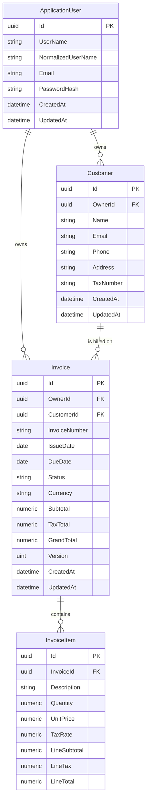

# Architecture

## Overview

InvoiceFlow API is a **pragmatic modular monolith**: a single deployable ASP.NET Core application whose
code is organized by business feature rather than by technical layer. The goal is a codebase that a new
developer (or a potential client reviewing the repository) can understand in minutes, while leaving clear
seams for future growth.

The application deliberately avoids distributed-systems machinery. There is no message broker, no
microservice split, no CQRS framework, and no repository abstraction over EF Core. Those choices would add
operational cost and indirection without solving a problem this product currently has.

## Why a modular monolith

- **One process, one deployment unit.** Small-business invoicing does not need independent scaling of
  customers and invoices; a single API is cheaper to run and operate.
- **Simple transactions.** Invoice totals and their line items must stay consistent. A single database and
  a single process make that trivial; distributed consistency would not.
- **Clear boundaries without network boundaries.** Features live in separate folders with their own
  entities, configurations, endpoints, and validation. If a feature ever needs to be extracted, the folder
  is the unit of extraction.
- **Lower cognitive load.** Native ASP.NET Core features (dependency injection, model binding, filters,
  middleware, OpenAPI) are used directly instead of wrapping them in custom frameworks.

## Feature-based organization

```text
src/InvoiceFlow.Api/
├── Features/
│   ├── Auth/          # ApplicationUser, Identity, JWT, auth endpoints, admin provisioning
│   ├── Customers/     # Customer entity, validation, contracts, and CRUD endpoints
│   └── Invoices/      # Invoice, InvoiceItem, InvoiceStatus (endpoints: Phases 5–6)
├── Common/            # cross-cutting API concerns: error handling, pagination contracts
├── Infrastructure/
│   ├── Persistence/   # AppDbContext, audit contract, EF Core migrations
│   ├── HealthChecks/  # health response contract
│   └── OpenApi/       # OpenAPI document configuration
├── Program.cs         # composition root and HTTP pipeline
└── appsettings.json
```

Each feature folder contains only what that feature needs: entities, EF Core configurations, request and
response contracts, controllers, feature-specific validation, and services. Features may reference
`Common` and `Infrastructure`, but must not reach into each other's internals. When one feature needs data
owned by another, it goes through a small public service or query contract exposed by the owning feature.

### Why controllers

Controller-based APIs keep request handling, model binding, validation attributes, and OpenAPI metadata
in one predictable place. They also read naturally to .NET reviewers, which matters for a portfolio
repository. Minimal APIs are a fine alternative, but mixing both styles would add inconsistency for no
benefit.

## Application boundaries

| Boundary        | Responsibility                                                        |
| --------------- | --------------------------------------------------------------------- |
| Auth            | Registration, credential verification, JWT issuing, role assignment    |
| Customers       | Customer ownership, CRUD, uniqueness of e-mail per owner, deletion rules |
| Invoices        | Invoice lifecycle, line items, server-side totals, numbering           |
| Common          | ProblemDetails conventions, pagination envelope, shared primitives     |
| Infrastructure  | EF Core `DbContext`, migrations, health checks, auth configuration     |

Authorization is enforced at the edge of each feature: every customer and invoice query is scoped to the
authenticated user, except for administrators.

## Authentication and authorization

### ASP.NET Core Identity

Authentication uses ASP.NET Core Identity for user storage and password hashing. The application uses
`AddIdentityCore<ApplicationUser>()` with `IdentityRole<Guid>`, the EF Core stores, and `SignInManager`;
no cookie authentication schemes are registered because the API is token-based.

Configured policies:

| Setting               | Value                                           |
| --------------------- | ----------------------------------------------- |
| Unique e-mail         | Required (`User.RequireUniqueEmail`)             |
| Password minimum      | 12 characters                                   |
| Password complexity   | Upper-case, lower-case, digit, non-alphanumeric |
| Lockout threshold     | 5 failed attempts                               |
| Lockout duration      | 15 minutes                                      |
| Lockout for new users | Enabled                                         |

Passwords are hashed by Identity's PBKDF2 password hasher. The application never implements its own
cryptographic algorithms, and never returns or logs password hashes or security stamps.

### Registration flow

`POST /api/auth/register`:

1. Validate the request (e-mail format, required fields).
2. Reject an already registered e-mail with `409 Conflict`.
3. Begin an explicit `AppDbContext` transaction.
4. Create the user through `UserManager`, which normalizes the e-mail, validates the password policy, and
   hashes the password.
5. Create the `User` role lazily if it does not exist.
6. Add the user to the `User` role.
7. Commit the transaction and return `201 Created` with `{ id, email, role }`.

The endpoint never accepts a role from the client, never creates an Admin, and does not sign the user in.
If role assignment fails, the transaction is rolled back, so no partially registered account remains.

### Login flow

`POST /api/auth/login`:

1. Find the user by normalized e-mail.
2. Call `SignInManager.CheckPasswordSignInAsync(user, password, lockoutOnFailure: true)`.
3. Return the same generic `401` ProblemDetails for an unknown e-mail, a wrong password, and a locked-out
   account. This avoids disclosing whether an account exists.
4. On success, load the user's roles and issue an HS256 JWT.
5. Return `{ accessToken, tokenType: "Bearer", expiresIn }`.

Failed attempts increment Identity's access-failed count; the fifth failure locks the account for 15
minutes. No refresh token is issued in Phase 3.

### JWT claims and validation

| Claim | Value | Notes |
| ----- | ----- | ----- |
| `sub` | User id | `Guid`; used by `ICurrentUser` |
| `email` | User e-mail | |
| `role` | Identity role | One claim per role (`Admin`, `User`) |
| `iss` | `Jwt:Issuer` | Validated |
| `aud` | `Jwt:Audience` | Validated |
| `iat` | Issued-at | Unix seconds |
| `exp` | Expiration | Unix seconds |
| `jti` | Token id | Unique `Guid` |

Validation is strict:

- HS256 is the only accepted algorithm (`ValidAlgorithms`).
- Unsigned tokens are rejected (`RequireSignedTokens`).
- Issuer, audience, signature, and lifetime are validated.
- Clock skew is limited to 5 seconds.
- `MapInboundClaims` is disabled, the role claim type is `role`, and the name claim type is `email`.

`JwtOptions` is bound from the `Jwt` section and validated at startup. The signing key comes only from
`Jwt__SigningKey`, must be at least 32 bytes, and is never committed or logged. If it is missing or invalid,
the host fails to start with a clear message that does not include the key value.

### Authorization policies

| Policy              | Definition                  | Behavior                             |
| ------------------- | --------------------------- | ------------------------------------ |
| `AdminOnly`         | `RequireRole("Admin")`      | `403` for authenticated non-admins   |
| `AuthenticatedUser` | `RequireAuthenticatedUser()` | `401` for anonymous requests         |

`JwtBearerEvents.OnChallenge` writes a `401` ProblemDetails response and `OnForbidden` writes a `403`
ProblemDetails response. The two roles are `Admin` and `User`; public registration can only create `User`.

### Current user access

`ICurrentUser` is a small scoped service that reads the validated JWT `sub` claim and parses it as a
`Guid`. It returns `null` when the principal is unauthenticated, the claim is absent, or the value is not a
valid `Guid`. Ownership is never taken from a request body. `GET /api/auth/me` uses this service and looks
the user up again, so a token for a deleted account is rejected with `401`.

### Admin provisioning

Admin provisioning is an explicit command, never part of normal startup:

```bash
dotnet run --project src/InvoiceFlow.Api -- --provision-admin
```

It is disabled by default and requires:

| Setting                      | Purpose                    |
| ---------------------------- | -------------------------- |
| `AdminProvisioning__Enabled` | Must be `true` to run      |
| `AdminProvisioning__Email`   | Initial admin e-mail       |
| `AdminProvisioning__Password` | Initial admin password     |

The command ensures the `Admin` and `User` roles exist, creates the admin account once, and is idempotent.
It never overwrites an existing password, never promotes an existing non-admin account, and never logs the
password. Concurrent runs are constrained by Identity's unique e-mail/username indexes and the
find-before-create check.

### Error responses and Swagger

- Validation failures return `400` with `ValidationProblemDetails`.
- Duplicate registration returns `409`; invalid login returns `401`.
- Missing, invalid, expired, or unsigned tokens return `401`; insufficient roles return `403`.
- Unhandled exceptions in Production return `500` through `UseExceptionHandler()` and `AddProblemDetails()`
  without stack traces or internal details.
- The OpenAPI document declares a document-level Bearer security scheme. An operation transformer clears
  security for `[AllowAnonymous]` actions, and `/health` is documented as anonymous. Swagger UI therefore
  supports the register → login → Authorize → `/api/auth/me` workflow.

## Persistence

### EF Core and PostgreSQL

- **EF Core 10 with the Npgsql provider** and PostgreSQL 17.
- One `AppDbContext` inherits from `IdentityDbContext<ApplicationUser, IdentityRole<Guid>, Guid>`.
  No generic repository and no unit-of-work wrapper — `DbContext` already provides both, and hiding it
  would obscure query behavior and transaction scope.
- Entity type configurations (`IEntityTypeConfiguration<T>`) live next to the entity that owns them and are
  applied by assembly scan.
- Migrations are applied explicitly (CLI in development, a deployment step in production), never
  automatically on startup. `EnsureCreated()` is not used.

### Entity relationships



Identity's role tables (`AspNetRoles`, `AspNetUserRoles`, claims, logins, tokens) are managed by ASP.NET
Core Identity and omitted from the diagram for readability.

### Schema conventions

| Data                    | PostgreSQL type      | Rationale                                            |
| ----------------------- | -------------------- | ---------------------------------------------------- |
| Identifiers             | `uuid`               | Non-guessable, client-generatable identifiers        |
| Audit timestamps        | `timestamp with time zone` | Always UTC; set by `AppDbContext`               |
| Invoice dates           | `date`               | `DateOnly` — no time component or time zone ambiguity |
| Monetary values         | `numeric(18,2)`      | Exact decimal arithmetic; never floating point       |
| Quantity                | `numeric(18,3)`      | Fractional units (for example hours)                 |
| Tax rate                | `numeric(5,2)`       | Percentage, for example `20.00` for 20%              |
| Invoice status          | `varchar(20)`        | Stable string values (`Draft`, `Sent`, `Paid`, `Cancelled`) |
| Names and descriptions  | bounded `varchar`    | Limits documented in [requirements.md](requirements.md) |

`AppDbContext` overrides `SaveChanges`/`SaveChangesAsync` to maintain `CreatedAt` and `UpdatedAt` in UTC for
entities implementing `IAuditableEntity`.

### Identity persistence

`ApplicationUser : IdentityUser<Guid>` and `IdentityRole<Guid>` use ASP.NET Core Identity's standard tables
and indexes, including the unique normalized user name. `CreatedAt` and `UpdatedAt` are added for auditing.
Phase 3 adds the authentication endpoints, password hashing through Identity, JWT issuing, and the
authorization policies described above; the persistence schema itself is unchanged from Phase 2.

### Ownership integrity

An invoice must belong to the same user that owns its customer. This invariant is enforced by the database,
not only by application code:

- `Customers` has an alternate key on `(Id, OwnerId)`.
- `Invoices` references `Customers (Id, OwnerId)` with a composite foreign key on
  `(CustomerId, OwnerId)`.
- `Invoices.OwnerId` additionally references `AspNetUsers (Id)`.

As a result, inserting or updating an invoice whose owner differs from the customer's owner fails with a
foreign-key violation. Authorization and ownership filtering remain application concerns for later phases.

### Delete behaviors

| Relationship              | Behavior   | Reason                                                        |
| ------------------------- | ---------- | ------------------------------------------------------------- |
| Customer → ApplicationUser| `RESTRICT` | Deleting a user must not silently remove financial records     |
| Invoice → ApplicationUser | `RESTRICT` | Same                                                           |
| Invoice → Customer        | `RESTRICT` | A customer with invoices cannot be deleted                     |
| InvoiceItem → Invoice     | `CASCADE`  | Items have no meaning without their invoice                    |

Cascade from invoice to items is safe because invoice deletion will be limited to drafts by the application
in Phase 6; no other path deletes invoices. Soft deletion is intentionally not introduced.

### Check constraints

Structural integrity is also enforced in PostgreSQL:

- `Customers.Name` must contain a non-blank value.
- Invoice totals (`Subtotal`, `TaxTotal`, `GrandTotal`) cannot be negative.
- `Invoices.DueDate >= Invoices.IssueDate`.
- `Invoices.Status` must be one of the four known values.
- Invoice item `Quantity > 0`, `UnitPrice >= 0`, `TaxRate` between 0 and 100, and all line totals
  non-negative.

Business workflows (status transitions, recalculation, numbering) are not implemented as database triggers.

### Concurrency

`Invoice.Version` is a `uint` row-version property configured with `IsRowVersion()`. The Npgsql provider
maps it to PostgreSQL's internal `xmin` system column, which changes on every row update; no extra physical
column is created. EF Core includes `xmin` in the `WHERE` clause of updates and throws
`DbUpdateConcurrencyException` when the row changed since it was read.

HTTP handling of concurrency conflicts (returning `409 Conflict` with a ProblemDetails body) belongs to
Phase 6.

### Migrations

The initial migration `InitialCreate` creates the Identity tables, `Customers`, `Invoices`, and
`InvoiceItems`, including all foreign keys, indexes, and check constraints. It is committed to the
repository and reproducible with:

```bash
dotnet tool restore
dotnet ef database update --project src/InvoiceFlow.Api --startup-project src/InvoiceFlow.Api
```

## Health and readiness

`GET /health` is a **readiness** endpoint. It runs the registered ASP.NET Core health checks, currently
including a `DbContext` connectivity check for PostgreSQL:

- `200 OK` with `{"status":"Healthy"}` when the database is reachable.
- `503 Service Unavailable` with `{"status":"Unhealthy"}` when it is not.

The application starts even when PostgreSQL is unavailable; only readiness fails. The response writer is a
small dedicated component so the JSON contract stays stable, and it never includes connection strings or
exception details. If a pure liveness signal is needed later, a separate endpoint can be added without
changing `/health`.

## Testing strategy

| Level       | Tooling                                   | Scope                                                          |
| ----------- | ----------------------------------------- | -------------------------------------------------------------- |
| Unit        | xUnit                                     | JWT options/tokens, current user, entity defaults, EF model metadata |
| Integration | xUnit + Testcontainers + `WebApplicationFactory` | Real PostgreSQL: auth flows, JWT validation, policies, provisioning, persistence, constraints, health, HTTP contracts |

Guidelines:

- Unit tests cover behavior that is deterministic and has no I/O.
- Integration tests use a real PostgreSQL container, never the EF Core InMemory provider, and apply the
  real migrations rather than `EnsureCreated()`.
- A single container is shared per test collection; data is truncated between tests so tests stay isolated
  and repeatable.
- Tests assert observable behavior, not implementation details, and are not added purely for coverage
  numbers.

## Implementation notes

### Phase 1

- The application is composed in `Program.cs`.
- OpenAPI is generated by the built-in `Microsoft.AspNetCore.OpenApi` package; Swagger UI is served by
  `Swashbuckle.AspNetCore.SwaggerUI`, which only renders the generated document. Both are enabled in
  Development only.
- HTTPS redirection is applied outside Development.
- Configuration comes from `appsettings.json`, `appsettings.{Environment}.json`, environment variables, and
  command-line arguments, in the standard ASP.NET Core order. No secrets are committed.
- Warnings are treated as errors and code style is enforced during build.

### Phase 2

- `AppDbContext` is registered with `AddDbContext` using `ConnectionStrings:DefaultConnection`.
- The database readiness check uses `AddDbContextCheck<AppDbContext>()`.
- EF Core migrations are generated into `Infrastructure/Persistence/Migrations`; generated files are
  excluded from hand-written style rules in `.editorconfig`.
- The `dotnet-ef` CLI is pinned as a local tool in `dotnet-tools.json`.
- Integration tests require Docker; if Docker is unavailable, persistence tests cannot run and Phase 2
  remains unverified.

### Phase 3

- Service composition lives in `Infrastructure/ServiceCollectionExtensions.cs` so the explicit
  provisioning command reuses exactly the same registrations as the web host.
- Identity uses `AddIdentityCore` with roles, EF stores, and `SignInManager`; no cookie schemes are added.
- JWT options are validated at startup; the signing key is read only from `Jwt__SigningKey`.
- Registration uses an explicit transaction so a role-assignment failure cannot leave a partial account.
- Login uses `SignInManager.CheckPasswordSignInAsync(..., lockoutOnFailure: true)`.
- Authorization policies are `AdminOnly` and `AuthenticatedUser`; 401/403 responses are written as
  ProblemDetails by JWT bearer events.
- Admin provisioning is an explicit `--provision-admin` command, disabled by default.
- Swagger uses a document-level Bearer scheme; anonymous operations opt out via an operation transformer.
- Integration tests use a test-only authorization controller registered only in the test host; no
  production endpoints exist solely for testing.

### Phase 4

- Customer CRUD endpoints are protected by the `AuthenticatedUser` policy and derive ownership only from
  the validated JWT. Normal users are scoped to their own records; administrators can manage all records.
- Customer request contracts trim input and validate names, e-mail addresses, phone numbers, tax numbers,
  and field lengths. Customer e-mail addresses are normalized to lowercase.
- Per-owner, case-insensitive customer e-mail uniqueness is enforced by both application checks and a
  PostgreSQL expression index, with unique-constraint handling for concurrent requests.
- Customer deletion checks for invoices and returns `409 Conflict`; the restrictive foreign key provides
  the final guard against a concurrent invoice creation.
- Customer lists support case-insensitive search, allow-listed deterministic sorting, and 1-based
  pagination capped at 100 items per page.
- Integration tests exercise CRUD, ownership isolation, administrator access, validation, search,
  pagination, migrations, database constraints, and concurrent duplicate creation against PostgreSQL.
